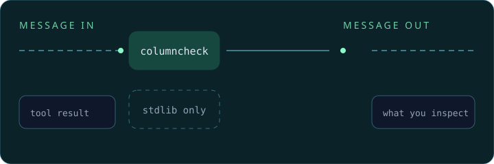

<p align="center">
  
</p>

<p align="center">
  <a href="https://pypi.org/project/columncheck/"></a>
  <a href="https://pypi.org/project/columncheck/"></a>
  <a href="https://pypi.org/project/columncheck/"></a>
  <a href="https://github.com/sandeshbagmare/columncheck/actions/workflows/ci.yml"></a>
  <a href="https://github.com/sandeshbagmare/columncheck/blob/main/LICENSE"></a>
  <a href="https://sandeshbagmare.github.io/columncheck/"></a>
  <a href="https://pypi.org/project/columncheck/"></a>
</p>

<h3 align="center">find the CSV defect before the pipeline does</h3>
<p align="center"><em>Standard library only. No runtime dependencies. Python 3.9+.</em></p>

<p align="center">
  
</p>

## Install

```console
pip install columncheck
```

## Use

```console
columncheck data.csv                       # structure only
columncheck data.csv --header a,b,c        # ... and the columns it must have
columncheck data.csv --sniff               # guess , ; tab or | first
columncheck data.tsv --delimiter $'\t'
columncheck data.csv --allow-ragged         # field counts may vary
columncheck data.csv --json                 # for a dashboard, exit 1 on problems
```

```python
from columncheck import lint_csv, sniff_delimiter

problems = lint_csv(open("data.csv", "rb").read(), expected_header=["id", "total"])
for problem in problems:
    print(problem)            # line 418: 4 field(s), header has 5 (ragged-row)
```

## Checks

| code | what it means |
| ---- | ------------- |
| `bom` | the file starts with a byte order mark; the first column is `\ufeffname` |
| `nul-byte` | a NUL byte, which most parsers choke on later |
| `empty-file` | no header row at all |
| `empty-header` | the header row is empty, or a column has no name |
| `padded-header` | `" a "` — invisible in a spreadsheet, painful in SQL |
| `duplicate-header` | the same name twice; `DictReader` silently keeps the last |
| `ragged-row` | a row whose field count differs from the header |
| `missing-column` / `extra-column` | the file is not what you expected |
| `encoding` | the bytes are not valid in the encoding you asked for |
| `malformed` | the CSV itself is broken |

Quoted fields containing commas or newlines are handled properly, and row numbers stay
correct across a multi-line quoted field.

## Limits

- Structure only: it does not check types, date formats or value ranges.
- It reads the whole file into memory once; that is fine for the sizes that fit in a
  spreadsheet and wrong for a 30 GB dump — use a streaming validator there.
- `sniff_delimiter` looks at the first 50 rows and the four candidates `, ; \t |`.

## Development

```console
python -m venv .venv
.venv/bin/pip install -e ".[test]"
.venv/bin/pytest
```

## License

MIT.
